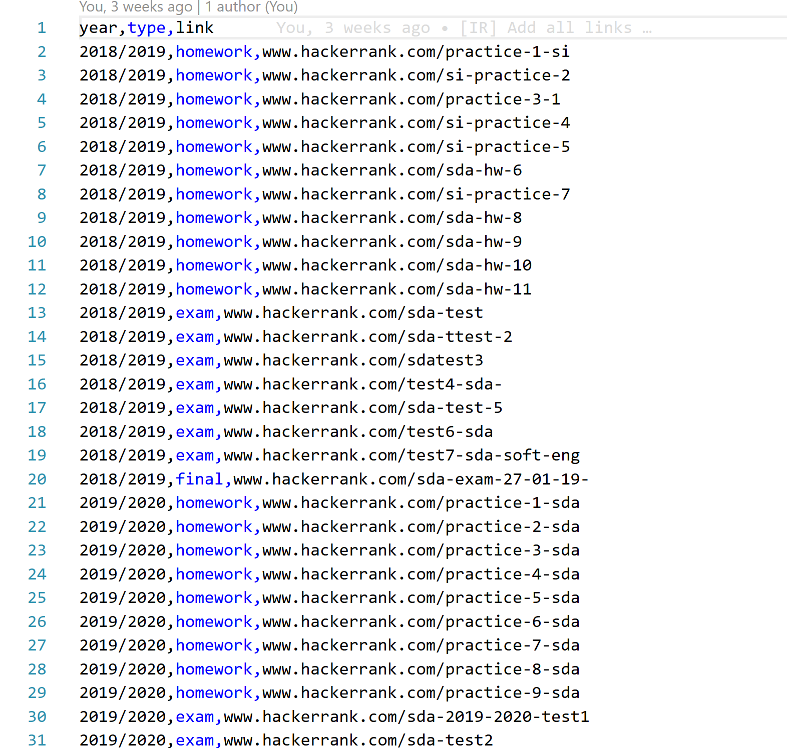
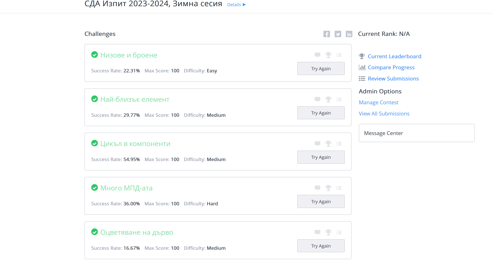
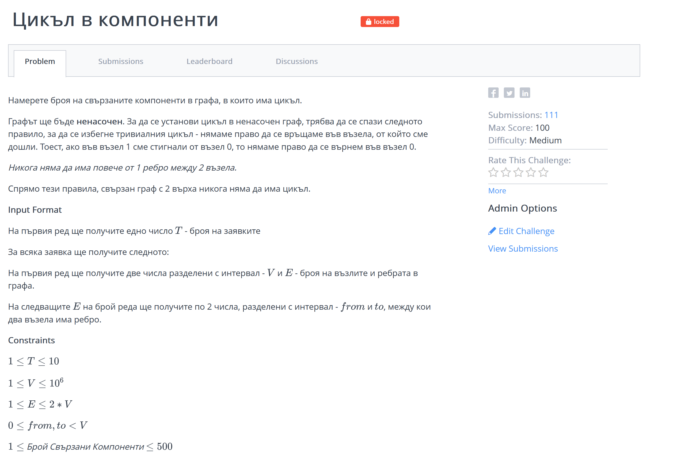
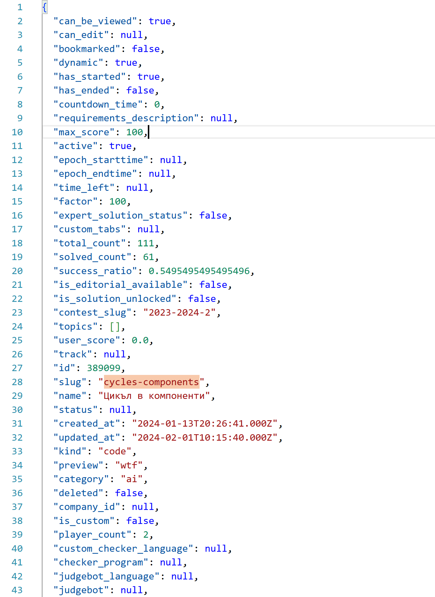
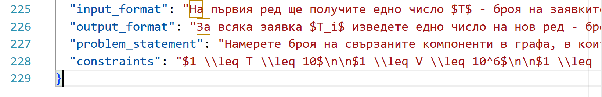
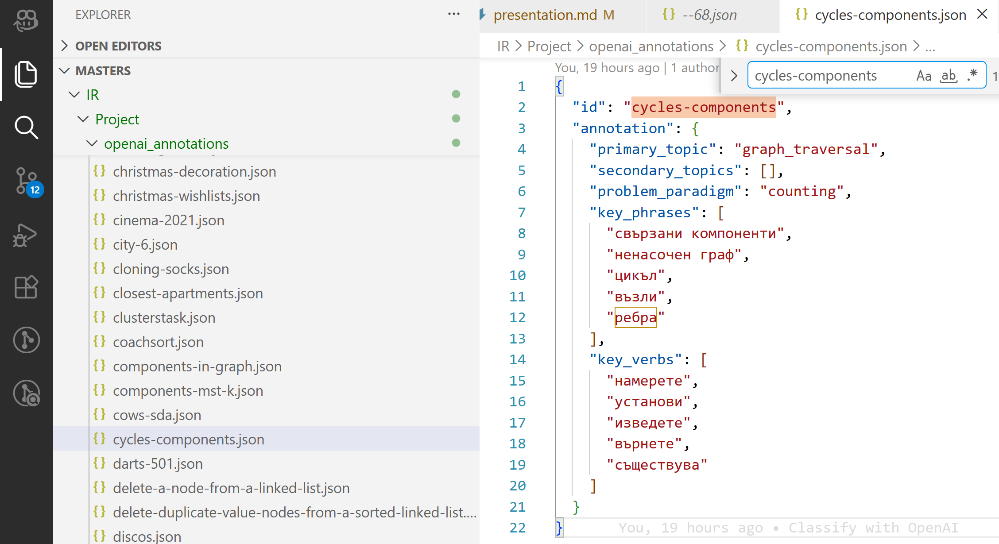
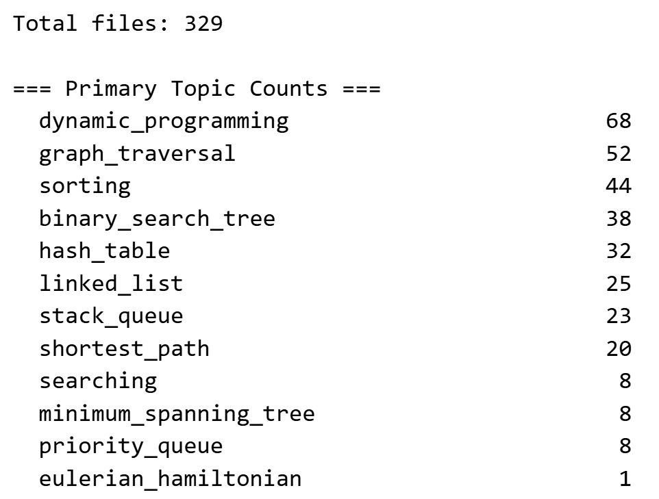

# Система за извличане на информация от алгоритмични задачи на български език

Теодор Светославов Костадинов
ф.н. 5MI3400816
Извличане на Информация, зимен семестър 2025/2026

---

# 1. Избор на задача

_Проблем: Всяка година от 2018 насам в курса по СДА се добавят около 30 нови задачи. Подготовката на студентите и намирането на подобни задачи става все по-трудно._

**Подобряване на достъпа до материалите за студенти в СДА курса.**

---

**Цел:** Изграждане на система за извличане на информация, която:

1. **Извлича** условията от HackerRank чрез уеб скрейпинг
2. **Индексира** чрез TF-IDF, BERT и хибриден модел
3. **Търси и подрежда** по прилика, оценени чрез IR метрики
4. **Предоставя** уеб интерфейс за търсене и препоръчване

---

# 2. Данни

Публичен исторически списък на всички състезания давани по СДА от 2018 насам: [Линк](https://docs.google.com/document/d/1W0gjdUR_aEuCiyCnP8njMuswomJlZle6riAu0BaE038/edit?tab=t.0)

---

# Как изглеждат данните?

Първоначалният документ конвертиран към CSV:

---

# Как изглеждат данните?

Състезанието https://www.hackerrank.com/contests/2023-2024-2/challenges показано чрез browser:

---

... и конкретна задача от състезанието например _cycles-components_...

---

---

# Как изглеждат данните?

Във JSON format след скрейпване:

---

Атрибутите, които ще използваме:

---

# 3. Данни - Уеб скрейпинг

- Автоматизиран скрейпър с **Playwright** (нужда от автентикация)
- Извлича: условие, трудност, точки, успеваемост, тагове, състезание
- Динамично разширяване + дедупликация

---

# Aнотиране на данните

- Слабо анотиране чрез OpenAI агент
- Дефиниране на класове задачи според категориите лекции по конспект

---

---

# Как изглеждат данните? (обобщение)

- 329 текстови файла
- Съдържат условието на всяка задача в суров текстов формат
- Категория на задачата (_label_)

---

---

# 4. Предобработка на текста

| Стъпка                    | Описание                                           |
| ------------------------- | -------------------------------------------------- |
| Нормализация              | Премахване на HTML, Markdown, LaTeX, малки букви   |
| Извличане на секции       | Условие + входен формат + изходен формат           |
| Токенизация и лематизация | **CLASSLA** - специализиран за южнославянски езици |
| Стоп-думи                 | **stopwordsiso** за български                      |

---

<!-- _class: invert -->

# 5. Модели за извличане на информация

---

# Модел I: TF-IDF

- Лематизиран текст към TF-IDF вектори (униграми + биграми)
- Косинусова мярка за прилика

### Предимство: Силен при категории с характерна лексика

---

# Модел II: BERT

- Многоезичен _Transformer_ за изречения
- Косинусова мярка за прилика

### Предимство: Семантично разбиране отвъд лексиката

---

# Модел III: Хибриден

Линейна интерполация на TF-IDF и BERT:

$$score = (1 - \alpha) \times tfidf\_sim + \alpha \times bert\_sim$$

- α вариране на параметъра от 0.0 до 1.0 със стъпка 0.1
- **Оптимално: α = 0.4** → 60% TF-IDF + 40% BERT

### Предимство: Комбинира лексикално и семантично търсене

---

# 6. Методика на оценка

- _**Leave-one-out**_: за всяка от 329 задачи
- Проверка дали принадлежат към **същата категория**

| Метрика   | Описание                                       |
| --------- | ---------------------------------------------- |
| **P@K**   | Дял на релевантните сред Top-K                 |
| **MRR**   | Средна реципрочна позиция на първия релевантен |
| **MAP@5** | Средна точност на подреждането до позиция 5    |

---

<!-- _class: invert -->

# 7. Резултати

---

# Допълнителни NLP експерименти

| Експеримент           | Метрика  | Стойност |
| --------------------- | -------- | -------- |
| PMI класификатор      | Accuracy | 0.333    |
| PMI със слети класове | Top-1    | 0.226    |
| PMI със слети класове | Top-5    | 0.903    |
| Извличане на слотове  | Accuracy | 0.307    |

_Подходите чрез правила са **недостатъчни**_

---

# Сравнение на моделите за извличане

| Модел                | P@1       | P@3       | P@5       | MRR       | MAP@5     |
| -------------------- | --------- | --------- | --------- | --------- | --------- |
| TF-IDF (лематизиран) | 0.511     | 0.441     | 0.423     | 0.614     | 0.587     |
| BERT                 | 0.465     | 0.424     | 0.403     | 0.590     | 0.560     |
| **Хибриден (α=0.4)** | **0.535** | **0.453** | **0.423** | **0.638** | **0.605** |

**Хибридният модел е най-добър по всички метрики.**

---

# Анализ по категории (P@1)

| Категория             | TF-IDF    | BERT      | Хибриден  | Брой |
| --------------------- | --------- | --------- | --------- | ---- |
| binary_search_tree    | 0.842     | 0.763     | **0.921** | 38   |
| linked_list           | **0.840** | 0.800     | **0.840** | 25   |
| graph_traversal       | **0.673** | 0.596     | 0.654     | 52   |
| shortest_path         | **0.600** | 0.400     | **0.650** | 20   |
| sorting               | **0.500** | 0.341     | 0.477     | 44   |
| dynamic_programming   | 0.368     | 0.353     | **0.441** | 68   |
| hash_table            | 0.219     | **0.281** | 0.219     | 32   |
| minimum_spanning_tree | 0.250     | **0.625** | 0.375     | 8    |

---

# Анализ на резултатите

- **TF-IDF** превъзхожда при лексикално богати категории
  _BST, linked_list → P@1 > 84%_

- **BERT** е по-добър при семантично сходни задачи
  _hash_table, minimum_spanning_tree_

- **Хибридът** подобрява 4/9 категории спрямо TF-IDF
  _BST: 0.842 → 0.921, DP: 0.368 → 0.441_

- **Трудни категории**: dynamicprogramming, hashtable
  _Определят се от метода на решение, не от лексиката_

---

# 8. Уеб интерфейс (Streamlit)

| Раздел       | Функционалност                                               |
| ------------ | ------------------------------------------------------------ |
| **Search**   | Търсене по свободен текст, настройка на α                    |
| **Browse**   | Сортируема таблица с филтри по тема, трудност, състезание    |
| **Topics**   | Статистика и визуализация по теми, разпределение на трудност |
| **Practice** | Препоръчване на задачи на базата на решени                   |

---

<!-- _class: invert -->

# Демонстрация

---

# 9. Използвани технологии

| Компонент          | Технология                     |
| ------------------ | ------------------------------ |
| Уеб скрейпинг      | Playwright                     |
| TF-IDF индексиране | scikit-learn (TfidfVectorizer) |
| BERT ембединги     | sentence-transformers          |
| NLP за български   | CLASSLA                        |
| Стоп-думи          | stopwordsiso                   |
| Уеб интерфейс      | Streamlit                      |
| Анотиране          | OpenAI API                     |

---

# 10. Заключение

- Пълна IR система: скрейпинг → индексиране → търсене → уеб интерфейс
- **329 задачи** извлечени, **анотирани** с 14 категории
- Хибриден модел (60% TF-IDF + 40% BERT): **P@1 = 53.5%, MRR = 0.638**
- Допълнителни NLP експерименти потвърждават нуждата от векторни модели

---

# 11. Бъдещо развитие

- **Разширяване на заявки**
- **Learning to Rank** - модел за оптимално комбиниране на множество сигнали
- **Подобряване на анотациите** - ръчна проверка на OpenAI етикетите
- **Публично разгръщане** - предварително изчислени индекси и публикуване в облака

---

# Време за въпроси
